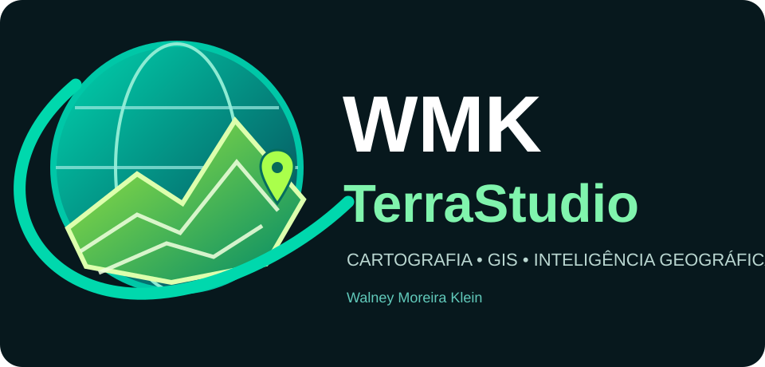

<p align="center">
  
</p>

<h1 align="center">WMK TerraStudio</h1>

<p align="center"><strong>Estúdio de cartografia, geoprocessamento e inteligência geográfica</strong></p>
<p align="center"><strong>Walney Moreira Klein — walneyk@hotmail.com</strong></p>
<p align="center">
  <a href="https://github.com/WalneyNF/WMK-TerraStudio/actions"></a>
  
  
  
</p>

> **Origem e atribuições:** O WMK TerraStudio é um fork independente de [RustGIS, do projeto opengeos](https://github.com/opengeos/RustGIS). Toda a base original permanece creditada aos respectivos autores e colaboradores, sob a licença **Apache-2.0**. A identidade WMK e a documentação em português são personalizações do fork. Este projeto **não é uma distribuição oficial** do RustGIS. Consulte [LICENSE](LICENSE), [ATTRIBUTION.md](ATTRIBUTION.md), [THIRD-PARTY-LICENSES.txt](THIRD-PARTY-LICENSES.txt) e [NOTICE de atribuições WMK](manuais/ATRIBUICOES.md).

## ⬇️ Download público — Windows e módulos WMK

**[Acessar os ZIPs públicos no GitHub Releases](https://github.com/WalneyNF/WMK-TerraStudio/releases/tag/wmk-v0.1.0-preview-20261115)**.

Pacotes de prévia separados, acessíveis sem a página de artefatos do GitHub Actions:

| Arquivo | Requisitos | Como começar |
| --- | --- | --- |
| `WMK-TerraStudio-Windows-x64-PREVIEW.zip` | Windows 64 bits | Extrair e executar `rustgis.exe` |
| `WMK-Planet-Watch-v0.1.zip` | PHP 8/XAMPP + Python 3 | Extrair, executar `INICIAR.cmd` |
| `WMK-Virtual-Journey-v0.1.zip` | PHP 8/XAMPP + navegador WebGL | Extrair, executar `INICIAR.cmd` |

A versão compilada publicada nesta prévia é **anterior à incorporação do ícone WMK oficial**; não confundir com a compilação mais recente, ainda em validação. Os ZIPs incluem `SHA256SUMS.txt` para conferência. A execução em Windows deve ser testada com o antivírus ativo.

O workflow [Publicar ZIPs para download](.github/workflows/wmk-public-download.yml) empacota novamente os módulos e publica os arquivos como ativos de uma Release.

## Apresentação

O WMK TerraStudio é uma proposta de ambiente profissional para **mapas, SIG (Sistema de Informações Geográficas), análise espacial, imagens de satélite e dados de localização**, construída sobre a base tecnológica do RustGIS. O motor original já oferece aplicativos desktop e web, biblioteca Python, linha de comando, integração por MCP e plugins.

A personalização **WMK será feita por etapas**. Nesta primeira etapa são alterados apenas a documentação e os recursos visuais do repositório. **A janela e os metadados Windows já usam WMK TerraStudio; a compilação Windows de teste passou após corrigir a tradução.** O motor ainda preserva identificadores RustGIS para compatibilidade. A inclusão do ícone original e o nome portátil `WMK-TerraStudio.exe` estão em validação no workflow. Não confunda esta etapa documental com uma versão pronta para instalar.

## Download do Windows (build verificado)

Um pacote **Windows x64** com a tradução pt-BR foi compilado com sucesso no GitHub Actions. [Baixe o artefato experimental](https://github.com/WalneyNF/WMK-TerraStudio/actions/runs/43685162247/artifacts/14150578532) (pode exigir login). Essa compilação anterior à integração da logo oficial ainda tem nome de arquivo interno `rustgis.exe`.

**Novo pacote com logo WMK e `WMK-TerraStudio.exe`:** acompanhe o workflow [Windows x64](https://github.com/WalneyNF/WMK-TerraStudio/actions/workflows/wmk-windows.yml). Só será disponibilizado como versão final depois que os testes do ícone e a compilação mais recente terminarem.

## Recursos da base RustGIS

| Área | O que permite fazer |
| --- | --- |
| Mapas | Visualizar mapas 2D, camadas, legendas, rótulos, projeções, globo 3D e terreno |
| Formatos | Abrir e converter GeoJSON, Shapefile, CSV, GeoPackage, GeoTIFF, GPX, KML/KMZ e vários outros formatos |
| Serviços | Utilizar serviços XYZ, WMS, WMTS, WFS, ArcGIS REST e tiles vetoriais, conforme plataforma |
| Edição | Criar e editar feições, vértices, atributos, simbologia e propriedades |
| Análise | Medir áreas e distâncias, criar buffers, cruzar camadas, analisar densidade, redes, relevo e visibilidade |
| Cartografia | Montar layouts, escalas, legendas, relatórios e exportações |
| Automação | Executar comandos por CLI, Python, ModelBuilder e agentes integrados por MCP |
| Extensões | Adicionar ferramentas com plugins WebAssembly e mecanismos de extensão disponíveis na versão original |

**Observação:** nem todos os recursos funcionam em todas as plataformas. Alguns dependem de serviços externos, credenciais ou programas opcionais. Consulte o [guia original](https://rustgis.app) para limitações e requisitos.

## Para que utilizar

- Preparar mapas de municípios, propriedades, rodovias, trilhas e regiões;
- Importar pontos GPS e visualizar percursos e pontos de interesse;
- Analisar áreas de cobertura e interseção entre regiões;
- Estudar dados de terreno, elevação, risco e recursos ambientais;
- Gerar mapas e arquivos geográficos para relatórios, pesquisas e aplicativos;
- Preparar dados para projetos WMK Geo Intelligence e WMK Geo Bridge (integrações **planejadas**, ainda não implementadas).

## Executar e compilar a base

### Aplicativo Windows

Enquanto a personalização WMK não tem um executável próprio testado, use os [lançamentos oficiais do RustGIS](https://github.com/opengeos/RustGIS/releases) somente para conhecer o motor de origem. **Esses executáveis não contêm modificações WMK.**

### Compilar o fork no Windows

Instale Rust **1.90 ou mais recente**, compilador C e as ferramentas descritas em [docs/installation.md](docs/installation.md). No PowerShell:

```powershell
git clone https://github.com/WalneyNF/WMK-TerraStudio.git
cd WMK-TerraStudio
cargo build --release --locked -p rustgis -p rustgis-cli
```

Essa compilação produz a base atual do fork. O processo de build Windows x64 personalizado será entregue em uma fase posterior, após a revisão da marca interna.

### Aplicativo web e Python

A versão pública de demonstração [web.rustgis.app](https://web.rustgis.app) pertence ao projeto original. Para automações Python, leia [docs/python.md](docs/python.md). Para agentes, leia [docs/mcp.md](docs/mcp.md).

## Idioma

O RustGIS possui um catálogo de interface em português no arquivo [`crates/ui-egui/src/i18n/pt.tsv`](crates/ui-egui/src/i18n/pt.tsv). A **revisão sistemática para pt-BR está prevista para a próxima etapa**; não anunciamos uma tradução WMK concluída nesta fase. O manual e esta apresentação já estão em português brasileiro.

## Organização dos manuais

Todos os futuros guias WMK serão organizados em [`manuais/`](manuais/README.md), seguindo o padrão:

- **Iniciante:** instalação, primeiros passos, interface e tutoriais simples;
- **Intermediário:** camadas, sistemas de coordenadas, análise e relatórios;
- **Avançado:** arquitetura Rust, Python, CLI, MCP, plugins e integrações;
- **Desenvolvedores:** compilação, testes, segurança, licenças e manutenção.

## 🌎 Planet Watch — primeiro módulo de observação mundial

O [WMK Planet Watch](modulos/planet-watch/README.md) é um laboratório independente em Python/HTML/JavaScript, com mapa interativo e três conectores públicos: **terremotos USGS, eventos naturais NASA EONET e meteorologia Open-Meteo**. Possui cache local, mensagens de erro e testes unitários automatizados.

Para iniciar com Python 3.10 ou superior, na raiz do repositório:

```powershell
cd modulos/planet-watch
py -3 server.py
```

Acesse **http://127.0.0.1:8788**. Veja o [catálogo de módulos WMK](modulos/catalogo.json).

**Escopo atual:** o módulo não incorpora ainda os fluxos ADS-B, AIS, satélites ou Traccar dos outros projetos WMK. O GPS permanece bloqueado até existir autorização de leitura no Bridge. O servidor é limitado a 127.0.0.1 e não deve ser exposto publicamente.

**Código-base e atribuições:** RustGIS / opengeos e seus colaboradores. **Personalização WMK:** Walney Moreira Klein — walneyk@hotmail.com.

## Acompanhamento do projeto e integração dos sistemas

O **[roadmap.html](roadmap.html)** lê o **[roadmap.json](roadmap.json)** e apresenta módulos, tarefas, dependências, progresso e estado de validação. Para abri-lo localmente, execute na raiz `py -3 -m http.server 8790` e visite `http://127.0.0.1:8790/roadmap.html`.

A arquitetura de integração está documentada em **[manuais/INTEGRACAO-MODULOS.md](manuais/INTEGRACAO-MODULOS.md)**, com endereços de serviços, contratos GeoJSON, MCP e restrições de segurança.

**Compilação Windows x64:** workflow manual [WMK TerraStudio — Windows](.github/workflows/wmk-windows.yml), que testa pt-BR e gera ZIP portátil quando concluído com sucesso. O executável interno ainda é `rustgis.exe` por compatibilidade com a base.

**Atenção:** o PNG da logo aprovada nesta conversa ainda precisa ser adicionado como arquivo binário ao repositório; o ícone nativo em Rust contém somente adaptação provisória da paleta. Não foi substituído pela arte original.

## Evolução do WMK TerraStudio

1. **Etapa 1 — documentação e identidade no GitHub:** README pt-BR, marca visual e estrutura de manuais.
2. **Etapa 2 — tradução de interface:** revisão do catálogo português e escolha pt-BR no aplicativo.
3. **Etapa 3 — identidade interna:** nome nas janelas, informações de produto, ícones e instaladores sem quebrar identificadores e formatos.
4. **Etapa 4 — testes Windows:** build pelo GitHub Actions, ZIP portátil, testes de execução e publicação de release.
5. **Etapa 5 — ferramentas WMK:** integração geográfica com os demais projetos, mapas de exemplo e novas funcionalidades.

Acompanhe o [roadmap WMK](manuais/ROADMAP-WMK.md) e, para a evolução do projeto original, [ROADMAP.md](ROADMAP.md).

## Segurança, licenciamento e colaboração

- Não publique senhas ou chaves de APIs dentro do código, dos logs ou dos projetos.
- Habilite plugins de processo e acesso completo MCP somente quando confiar nos componentes.
- Preserve os avisos legais do RustGIS e das dependências. O fork conserva a licença Apache-2.0 do código original.
- Evite alterar formatos de projeto, IDs de comandos e APIs públicas apenas para mudar a marca.

**Personalização WMK:** Walney Moreira Klein — walneyk@hotmail.com.

**Motor original:** [opengeos/RustGIS](https://github.com/opengeos/RustGIS) e seus colaboradores.
